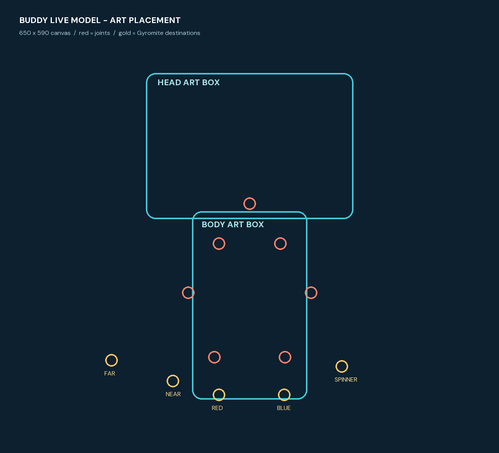

# Draw your own Buddy

Buddy's Live Model can wear your artwork. You can change one part, such as the head, or make a complete robot and game stage. The game still decides when Buddy turns, lifts, grips, and carries pieces. The moving Gyromite gyros and Stack-Up blocks keep their original artwork; your skin changes Buddy and the fixed stage around them.

**Start here:** Download the Buddy Skin Starter ZIP from the Create your Buddy page. The Artist Guide PDF is inside the ZIP, so you can keep it with your artwork. Open its `reference` folder for a picture of the current Buddy, a stage placement guide, and an arm segment guide. Keep those guides as reference layers; do not leave their coloured markers in finished artwork.

## Your first skin: change the head

1. Draw a head with a transparent background. Use the head box in the placement guide: it occupies x 190-460 and y 95-285 on a 650 x 590 stage. Keep its neck connection near the lower centre. Leave room near x 325, y 149 for Buddy's red Test light, which the app draws over your art.
2. Export it as a transparent PNG or an SVG with a `viewBox`. For crisp PNG art, work at twice the template size: 540 x 380 pixels for the 270 x 190 head box. Keep the proportions the same. The app fits your whole image into the box.
3. On your UNO Q, open **Setup > Skins**. Enter a skin name and artist name, then choose **Create Skin**. Choose **Head**, select the art file, and choose **Add This Part**.
4. In the preview, try **Home**, **Turn**, **Lift**, and **Grip**. Choose **Use This Skin** when you like the result. New visitors see the selected skin when they open Mission. On a Mission page that is already open, choose **Refresh Buddy** to show the change.

Only the head changes in this example. Buddy's body, arms, hands, and stage remain original. Game pieces always keep their original artwork.



## What belongs where

The stage is a 650 x 590 drawing area. The preview's **Show joint and game-piece guides** option overlays the important points. Red marks joints; yellow marks Gyromite destinations; green in the starter SVG marks Stack-Up trays.

| Artwork | How to prepare it |
|---|---|
| Background | Fill the stage however you like. The app puts Buddy and pieces in front of it. |
| Head | Fit your image inside the head box. It rotates around the neck point at (325, 265). |
| Body | Fit inside x 250-400, y 275-520. It stays behind the moving arms and hands. |
| Upper arms and forearms | Draw each as its own 64 x 128 image. Put one joint at (32, 8) and the other at (32, 120). The app stretches the segment between its moving joints. Leave a little overlap at each end to avoid gaps. |
| Hands | Draw each inside a 50 x 48 transparent image. The grip point is at its centre. Preview with hands open and closed. |
| Floor and platform | Use the placement guide for their visible areas. They do not move. |
| Gyromite fixtures | The far and near holders, spinner, and red and blue pads have fixed stations. Upload each as a separate image so the app places it for you. |
| Stack-Up fixtures | One tray image appears at all five tray positions. The linkage is a separate image. |
| Game pieces | Gyros and coloured blocks are supplied by R.O.B. Vision and cannot be replaced by a skin. Draw fixtures around their marked landing positions. |

The fixed Gyromite destinations are roughly (145, 469), (225, 496), (445, 477), (285, 514), and (370, 514). Stack-Up tray centres run from left to right at x 145, 230, 325, 410, and 500. The placement template marks all of them visually. These coordinates matter for holders, pads, trays, and the spinner. A background can be free-form; do not paint a false pad in a different place, because the original game pieces will still move to the real pad.

**Layer order:** background, floor, body, platform and fixtures, game pieces, arms, hands, head, and the red Test light. Art can extend slightly beyond its guide box, but anything outside the 650 x 590 stage is clipped. The small Game Table panel keeps its original look; skins change the main Live Model.

## PNG, SVG, and arm art

PNG is useful for painted, textured, or pixel art. Export with transparency. An opaque white rectangle will cover whatever should appear behind the part. SVG stays sharp when resized and works well for clean vector shapes. Use ordinary paths and shapes; do not include scripts, external images, web fonts, or links. The importer checks for these and explains when an SVG is unsuitable.

You can mix formats: a PNG head, SVG body, and SVG arms are fine. Keep each arm segment upright in its own image, with the first joint near the top and the second near the bottom. The app rotates and lengthens that image between the moving joints. It does not bend a single painted arm. Draw the upper arm, forearm, and hand as separate parts if you want a complete redesign.

Use **Setup > Skins** to upload one part at a time. The page builds the skin pack for you. You can also exchange a ZIP file with another artist. Export ZIP downloads the selected skin; Import Skin Pack loads one someone shared. Neither action makes the skin active until you choose **Use This Skin**.

## The skin.json contents list

Inside a skin ZIP, `skin.json` is a small text file that tells the app what the design is called and which file belongs to each part. It is not the drawing itself. The Setup page writes it automatically. Edit it by hand only if you want to prepare a ZIP in a text editor.

```json
{
  "schema": 1,
  "name": "Moonlight Buddy",
  "artist": "Your name",
  "assets": {
    "head": "assets/head.png",
    "left_upper_arm": "assets/left_upper_arm.svg"
  }
}
```

This example uses a PNG head and SVG left upper arm. The other customizable parts remain original Buddy art. `schema` tells the app which pack format to read; leave it at `1`. `name` and `artist` are shown in the skin library. Each entry under `assets` joins a **part name** on the left to a **file in the ZIP** on the right. Do not add entries for `gyro` or `block_red`, `block_white`, `block_blue`, `block_yellow`, or `block_green`; those game pieces are fixed.

To change the head file, place your art at `assets/head.png` inside the ZIP and use that exact spelling in `skin.json`. To add a body, put `assets/body.svg` in the ZIP and add `"body": "assets/body.svg"` inside `assets`, with a comma after the previous entry. Do not add a comma after the final entry. Use straight double quotation marks. If a file is renamed or missing, the import will tell you which entry does not match. Remove an entry to keep Buddy's original part.

The starter ZIP includes a sample file for every allowed artwork slot in `assets/`. These are editable examples of the right shape and size, not game pieces. Only `assets/head.svg` is listed in the starter's `skin.json`, so importing the ZIP changes the head alone. To try another example, add its exact filename to `skin.json` under `assets`. For instance, add `"body": "assets/body.svg"` after the head entry, separated by a comma. To keep the original body, leave that entry out. Unlisted example files are not saved when you import the ZIP; keep your starter ZIP as the source for them. The `reference` folder is for drawing guides and is ignored by the app.

## Check before you share

1. Preview Gyromite and Stack-Up. Make sure the original gyros and blocks land visibly on your custom holders or trays and between the hands.
2. Try a turn, lift, and grip. Look for gaps at the neck, shoulders, elbows, and wrists and for art that hides the Test light.
3. Check the skin on a phone-sized preview as well as a larger screen. The Live Model scales to fit, so small details may disappear.
4. Export the ZIP and import it again. Make sure its name and art reappear. Keep the ZIP as your own backup.

If something fails to load, Buddy's original art remains available: choose **Original Buddy** in Setup and activate it. Your other saved skins stay in the library.
